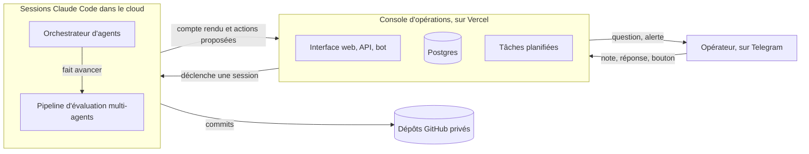

# Système d'agents IA : orchestration, agent critique, humain dans la boucle

Le schéma décrit ici s'applique à un processus métier en entreprise : traitement de demandes, tri de tickets,
préparation de dossiers. Des agents IA font le travail, un agent critique relit les décisions qui engagent, du code
sans IA décide de ce qui est réellement appliqué, et un humain n'est sollicité, par messagerie, que lorsque sa
réponse est nécessaire. Chaque décision garde son motif et l'avis du critique, et rien ne part vers un tiers sans
validation humaine. Ce sont deux exigences courantes dans la banque et l'assurance.

J'ai conçu et exploité ce système dans le cloud, sur Claude Code. Le cas traité est l'évaluation d'idées de projet
(marché, concurrence, modèle économique, offre). Il tient en trois composants : une console d'opérations, un
orchestrateur d'agents et un pipeline d'évaluation multi-agents.

Le code reste privé. Cette page décrit l'architecture, les règles et les incidents d'exploitation.

## Statut

Le système tourne sans poste allumé. Il a été en service chaque jour du 7 au 19 octobre 2026 et il est en pause
depuis. Un interrupteur le relance sans changer le code.

## Les principes réutilisables

- Un orchestrateur lance des agents spécialisés dans un ordre fixe et assemble leurs résultats.
- Avant une décision qui engage (créer un projet, l'arrêter, y rattacher une note), un agent critique relit la
  proposition et doit donner son accord.
- L'IA propose et le code applique. Les sessions rendent des actions typées, que la console valide une par une. Elle
  applique celles qui passent et refuse les autres.
- Les questions à l'humain arrivent sur Telegram, courtes, avec des options a), b), c). Sa réponse, par message ou
  par bouton, relance le travail.
- Un budget limite les passages par jour, un verrou tenu par la base empêche deux orchestrateurs de tourner en même
  temps, et un interrupteur coupe tout.
- Une session qui ne rend pas compte passe en échec après un délai. La relance est limitée et chaque échec est
  signalé.

## Les trois composants

### Console d'opérations

Le point d'entrée et le seul composant qui agit : interface web, API et bot Telegram (texte, vocal, Mini App). Elle
crée les demandes, déclenche les sessions cloud, reçoit leurs comptes rendus et applique les actions proposées, après
validation. Elle garde les secrets, et les sessions IA ne manipulent aucun jeton.

### Orchestrateur d'agents

Une session cloud lancée à chaque événement (note, réponse, lancement quotidien). Il trie les notes déposées, fait
créer le projet et son dépôt, fait avancer le pipeline dans la limite d'un budget, et pose à l'humain les questions
qui le bloquent. Il propose, la console applique.

### Pipeline d'évaluation multi-agents

Sept étapes, de l'idée brute au test de vente : accueil, élaboration, tri sur dossier, modèle économique, offre,
validation terrain, bilan. De l'élaboration à la validation terrain, chaque étape a un agent principal relu par un ou
plusieurs critiques. L'accueil et le bilan n'ont qu'un agent. L'IA propose un verdict, puis une machine à états en
Python le confirme ou le remplace, applique les plafonds et calcule la transition.

Deux exemples de résultat :

- Sur une idée de projet, le pipeline a chiffré l'espérance de gain à partir de sources et recommandé l'abandon,
  une recommandation confirmée par un agent critique.
- Sur une décision confiée à l'IA, le critique a contesté le premier choix du décideur, qui contredisait un mot de
  la note d'origine et s'appuyait sur des chiffres sans source. La décision est revenue à l'humain sous forme de
  question ([incident 3](docs/incidents.md)).

## Chiffres

Du 7 au 19 octobre 2026, comptés le 19 octobre dans le code et dans la base.

| Quoi | Valeur |
|---|---|
| Agents chargés dans les sessions cloud | 23 (21 pour le pipeline, 2 pour l'orchestrateur) |
| Étapes du pipeline | 7 |
| Tests automatisés | 424 (console, Vitest), 290 (pipeline, pytest), 272 (orchestrateur, pytest) |
| Lancements de l'orchestrateur | 27 : 23 terminés, 4 en échec (tous lancés avant le 9 octobre à midi) |
| Cas du banc d'essai du pipeline | 13 |

## Pour aller plus loin

- [Architecture, modèles, sécurité](docs/architecture.md) : les flux, le cycle d'une demande, la boucle question et
  réponse, les frontières de confiance.
- [Orchestrateur et pipeline](docs/orchestrateur-et-pipeline.md) : un lancement quotidien, les étapes, la machine à
  états, les décisions confiées à l'IA, le banc d'essai.
- [Incidents d'exploitation](docs/incidents.md) : ce qui a cassé, pourquoi, et ce qui a été changé.

## Stack

- Console d'opérations : Next.js 16, React 19, TypeScript, Drizzle ORM, Postgres serverless (Neon), Vercel (fonctions
  et tâches planifiées), bot Telegram avec grammY, transcription des vocaux par Whisper, tests Vitest sur PGlite.
- Orchestrateur et pipeline : routines Claude Code déclenchées par API, sous-agents Claude (Opus, Sonnet, Haiku) avec
  modèle et effort fixés par agent, Python 3.11 avec uv, pytest, contrats JSON Schema.
- Dépôts GitHub privés pour chaque projet et pour le travail des sessions.

## Auteur

Conception, règles et exploitation : Mathieu Recatala. Code développé avec Claude Code.

## Licence

Textes et schémas sous licence [CC BY 4.0](LICENSE). Ce dépôt ne contient pas de code.
