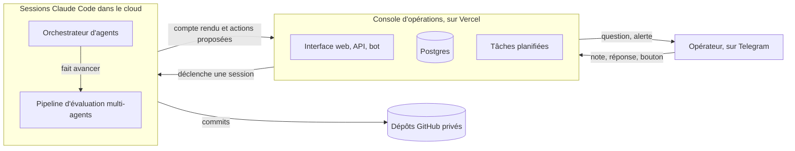

# Système d'agents IA : orchestration, agent critique, humain dans la boucle

J'ai conçu et exploité un système d'agents IA qui faisait avancer des dossiers dans le cloud, sur Claude Code. Le cas
traité : l'évaluation d'idées de projet (marché, concurrence, modèle économique, offre). Les agents font le travail,
un agent critique relit les décisions qui engagent, du code sans IA décide de ce qui est réellement appliqué, et un
humain n'est sollicité, par messagerie, que lorsque sa réponse est nécessaire.

Le même schéma s'applique à un processus métier en entreprise : traitement de demandes, tri de tickets, préparation
de dossiers. Il tient en trois composants : une console d'opérations, un orchestrateur d'agents et un pipeline
d'évaluation multi-agents.

Le code reste privé ; cette page décrit l'architecture, les règles et les incidents de production.

## Statut

Conçu pour tourner sur la durée, sans poste allumé. Il a été en service chaque jour du 7 au 19 octobre 2026. En pause
depuis le 19 octobre 2026, le temps de me consacrer à un autre projet ; il se relance par un interrupteur, sans
changement de code.

## Les principes réutilisables

- **Orchestration.** Un orchestrateur lance des agents spécialisés dans un ordre fixe et assemble leurs résultats.
- **Agent critique.** Avant une décision qui engage (créer un projet, l'arrêter, y rattacher une note), un second
  agent relit la proposition et doit donner son accord.
- **L'IA propose, le code applique.** Les sessions rendent des actions typées ; la console les valide une par une,
  applique celles qui passent et refuse les autres.
- **Humain dans la boucle.** Les questions arrivent sur Telegram, courtes, avec des options a), b), c). La réponse,
  par message ou par bouton, relance le travail.
- **Budgets et verrous.** Un budget limite les passages par jour, un verrou tenu par la base empêche deux
  orchestrateurs de tourner en même temps, et un interrupteur coupe tout.
- **Reprise après échec.** Une session qui ne rend pas compte passe en échec après un délai, la relance est limitée,
  et chaque échec est signalé.

## Les trois composants

#### Console d'opérations

Le point d'entrée et le seul composant qui agit : interface web, API et bot Telegram (texte, vocal, Mini App). Elle
crée les demandes, déclenche les sessions cloud, reçoit leurs comptes rendus et applique les actions proposées, après
validation. Elle garde les secrets : les sessions IA ne manipulent aucun jeton.

#### Orchestrateur d'agents

Une session cloud lancée à chaque événement (note, réponse, tour quotidien). Il trie les notes déposées, fait créer
le projet et son dépôt, fait avancer le pipeline dans la limite d'un budget, et pose à l'humain les questions qui le
bloquent. Il propose, la console applique.

#### Pipeline d'évaluation multi-agents

Sept étapes, de l'idée brute au test de vente : accueil, élaboration, tri sur dossier, modèle économique, offre,
validation terrain, bilan. De l'élaboration à la validation terrain, chaque étape a un agent principal relu par un ou
plusieurs critiques ; l'accueil et le bilan n'ont qu'un agent. L'IA propose un
verdict ; une machine à états en Python le confirme ou le remplace, applique les plafonds et calcule la transition.

Exemple de résultat : sur une idée de projet, le pipeline a chiffré l'espérance de gain à partir de sources et
recommandé l'abandon, une recommandation confirmée par un agent critique.

## Chiffres

Du 7 au 19 octobre 2026, comptés le 19 octobre dans le code et dans la base.

| Quoi | Valeur |
|---|---|
| Agents chargés dans les sessions cloud | 23 (21 pour le pipeline, 2 pour l'orchestrateur), plus 15 copies isolées pour le banc d'essai |
| Étapes du pipeline | 7 |
| Tests automatisés | 424 (console, Vitest), 290 (pipeline, pytest), 272 (orchestrateur, pytest) |
| Lancements de l'orchestrateur | 27 : 23 terminés, 4 en échec (tous lancés avant le 9 octobre à midi) |
| Cas du banc d'essai du pipeline | 13 |

## Pour aller plus loin

- [Architecture, modèles, sécurité](docs/architecture.md) : les flux, le cycle d'une demande, la boucle question et
  réponse, les frontières de confiance.
- [Orchestrateur et pipeline](docs/orchestrateur-et-pipeline.md) : un tour quotidien, les étapes, la machine à états,
  les décisions confiées à l'IA, le banc d'essai.
- [Incidents de production](docs/incidents.md) : ce qui a cassé, pourquoi, et ce qui a été changé.

## Stack

- Console d'opérations : Next.js 16, React 19, TypeScript, Drizzle ORM, Postgres serverless (Neon), Vercel (fonctions
  et tâches planifiées), bot Telegram avec grammY, transcription des vocaux par Whisper, tests Vitest sur PGlite.
- Orchestrateur et pipeline : routines Claude Code déclenchées par API, sous-agents Claude (Opus, Sonnet, Haiku) avec
  modèle et effort fixés par agent, Python 3.11 avec uv, pytest, contrats JSON Schema.
- Dépôts GitHub privés pour chaque projet et pour le travail des sessions.

## Méthode

Conception, règles et exploitation : Mathieu Recatala. Développement assisté par IA (Claude Code), validé par tests
automatisés et agents relecteurs.

## Licence

Textes et schémas sous licence [CC BY 4.0](LICENSE). Ce dépôt ne contient pas de code.
