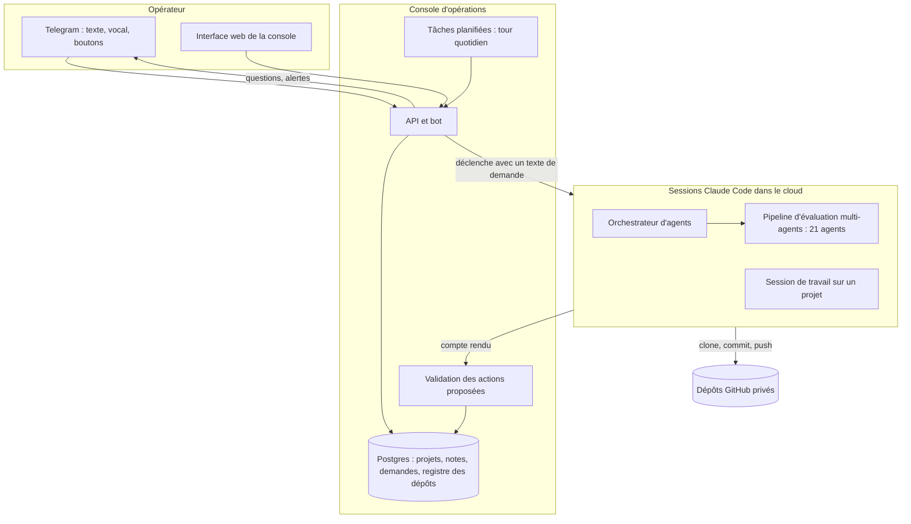
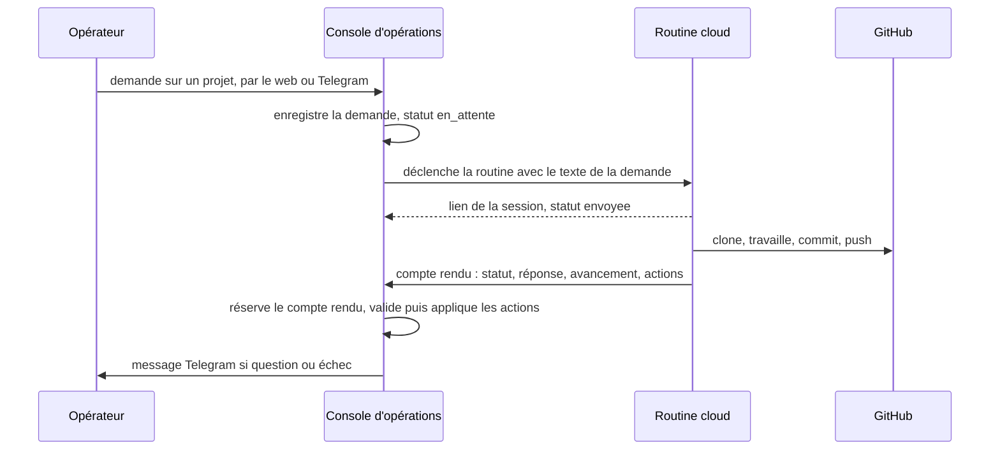
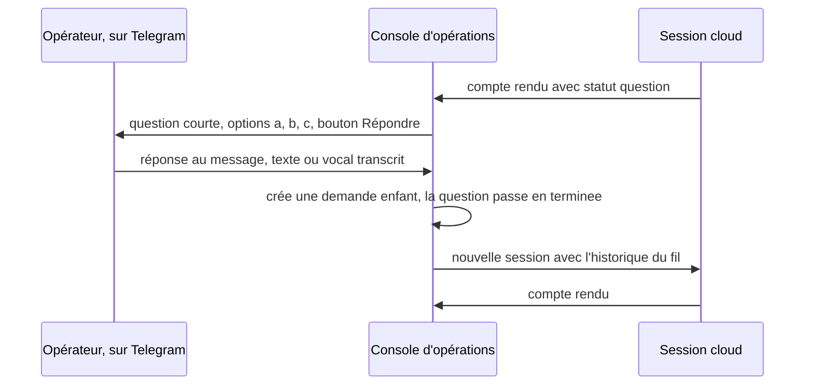
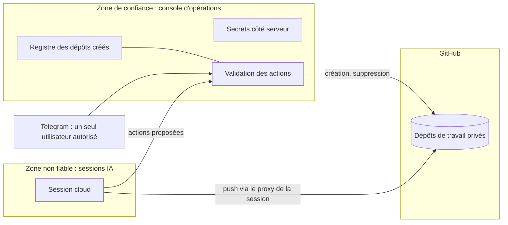

# Architecture

[Retour à l'accueil](../README.md)

## Vue d'ensemble

Trois idées guident le découpage.

1. **Les actions sensibles passent par un seul composant.** La console d'opérations parle à la base, à Telegram et au
   service qui lance les sessions, et crée les dépôts. Les sessions IA ne manipulent aucun jeton.
2. **L'IA propose, le code applique.** Une session rend un compte rendu qui contient des actions typées. La console
   les valide une par une, applique celles qui passent et liste les autres.
3. **La logique est dans des fichiers.** Consignes en Markdown, contrats en JSON, règles de transition en Python.
   En principe, on peut remplacer Claude Code sans toucher à la logique. Ce n'est pas testé : tout a tourné sur
   Claude.

Il y a trois sortes de sessions : l'orchestrateur, le pipeline et la session de travail ordinaire. Les deux premières
sont décrites dans la page [Orchestrateur et pipeline](orchestrateur-et-pipeline.md). La dernière reçoit une tâche
sur un projet (« ajoute une CI », « corrige ce test ») et rend compte de la même façon.

## Cycle d'une demande

Toute session part d'une **demande** enregistrée en base. La console déclenche une routine Claude Code par son API,
avec le texte de la demande et l'historique du fil. La session clone le dépôt, travaille, pousse, puis rend son compte
rendu à la console. Elle finit dans l'un de trois états : `terminee`, `question` (elle a besoin de l'opérateur) ou
`echec`.

Détails qui comptent en production :

- **Compte rendu reçu deux fois** : la console marque le compte rendu comme reçu, par une mise à jour atomique, avant
  d'appliquer quoi que ce soit : un POST rejoué n'a aucun effet.
- **Déclenchement sans réponse** : l'appel à la routine est abandonné après un délai fixe, la demande passe en échec
  d'envoi et l'opérateur le voit.
- **Session muette** : une demande de l'orchestrateur restée `envoyee` plus de quatre heures passe en `echec`.

## Boucle question et réponse sur Telegram

Quand une session a besoin de l'opérateur, la question arrive sur son téléphone. Il répond au message, en texte ou en
vocal. La réponse crée une demande enfant, rattachée à la question, et une nouvelle session reprend avec l'historique
du fil.

Pour l'orchestrateur, la réponse ne lance pas une session sur le projet : elle déclenche l'orchestrateur lui-même,
avec l'événement « réponse », qui l'applique dans le pipeline.

Le format des questions est imposé (une phrase, options a), b), c), 700 caractères au plus) : la première version
était illisible sur un téléphone ([incidents](incidents.md)).

## Modèle et effort par agent

Le modèle et l'effort se fixent agent par agent, dans l'en-tête de chaque fichier d'agent. Le principe : le meilleur
modèle et un effort élevé là où une erreur coûte cher (idée, modèle économique, décisions), un modèle plus léger pour
le travail de forme.

| Agents | Nombre | Modèle | Effort |
|---|---|---|---|
| Élaboration, tri sur dossier, modèle économique (principal et critiques), décideur et son critique | 11 | Opus | élevé |
| Tri et critique de l'orchestrateur | 2 | Opus | élevé |
| Offre, validation terrain, conformité, juge du banc d'essai | 6 | Opus | par défaut |
| Accueil, démo de l'offre, bilan | 3 | Sonnet | par défaut |
| Signal (transforme un événement dicté en données structurées) | 1 | Haiku | par défaut |

Soit 23 agents de production. Les 15 agents du banc d'essai sont des copies isolées des agents d'étapes, sans accès
aux fichiers.

## Sécurité et frontières de confiance

Les règles, telles qu'elles sont appliquées :

- **Aucune manipulation de jeton par une session IA.** L'accès à un dépôt passe par l'outil d'attachement de la
  session et son proxy. Les consignes interdisent toute commande qui afficherait l'environnement, la configuration git
  ou une URL avec un identifiant.
- **L'IA ne supprime jamais rien.** Seule la console supprime un dépôt, et seulement un dépôt inscrit au registre des
  dépôts qu'elle a elle-même créés. La suppression est programmée à J+7 après l'arrêt d'un projet, avec un bouton
  « Garder le dépôt ».
- **Actions bornées.** Neuf types d'action, chacun avec ses champs. Une action sur un projet que l'orchestrateur ne
  gère pas est refusée, ce qui protège les autres projets. Un validateur local vérifie le compte rendu avant l'envoi,
  et le serveur le revalide.
- **Rien vers un tiers.** Aucune session n'envoie de message, de courriel ou de publication à quelqu'un d'autre que
  l'opérateur.
- **Bot fermé.** Un seul utilisateur autorisé.
- **Liste d'autorisations au plus juste.** Le dépôt où démarrent les sessions cloud déclare la liste précise des
  commandes dont elles ont besoin, et rien de plus large.
- **Dépôt de travail privé, publication séparée.** Un dépôt où ont travaillé des sessions garde leurs consignes dans
  son historique git. Il reste privé ; une version publique est un nouveau dépôt, sans l'historique de travail, passé
  au scanner de secrets et relu.

## Garde-fou adversarial

En dehors des sessions cloud, le poste de travail a un agent « avocat du diable » que Claude Code lance avant toute
recommandation, tout plan, toute construction de plus d'une heure et toute action vers l'extérieur (publication,
envoi, dépense). Il cherche ce qui est faux, non prouvé ou risqué et rend un verdict : continuer, corriger ou arrêter.
Sur un verdict « arrêter », Claude Code a pour consigne de s'arrêter tant que l'opérateur ne l'a pas levé lui-même.
