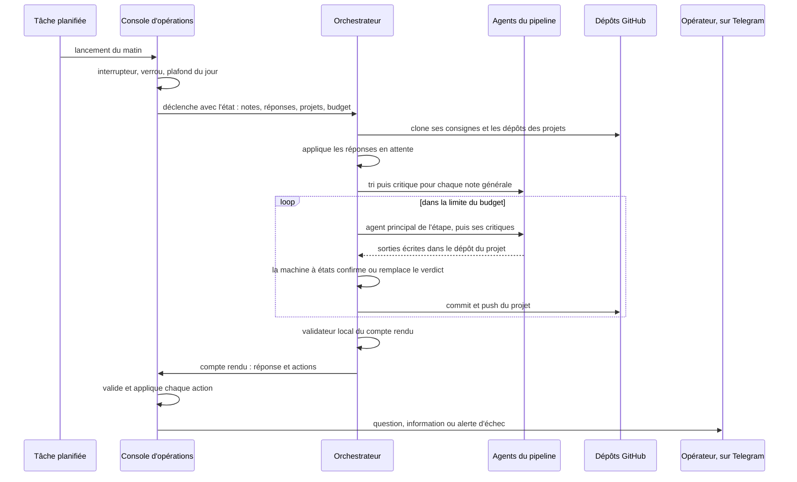
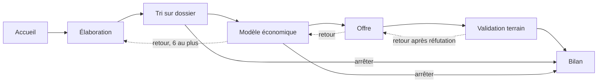
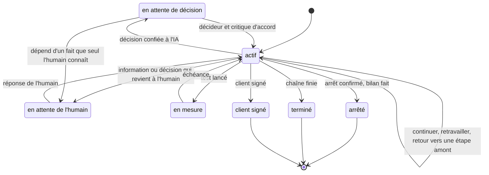

# Orchestrateur d'agents et pipeline d'évaluation multi-agents

[Retour à l'accueil](../README.md)

Le cas traité : une idée de projet est déposée en quelques minutes, par note écrite ou dictée. Le système doit la
préciser, la confronter à un modèle économique chiffré, et recommander de la tester ou de l'arrêter, en sollicitant
l'humain le moins possible.

## L'orchestrateur d'agents

L'orchestrateur est une session Claude Code lancée dans le cloud par la console d'opérations. Il ne garde rien en mémoire
entre deux lancements : tout son état est dans la base et dans les dépôts.

### Ce qui le déclenche

| Événement | Origine |
|---|---|
| Note | l'opérateur dépose une note générale ou une note sur un projet qu'il gère |
| Réponse | l'opérateur répond à une de ses questions sur Telegram |
| Client signé | bouton sur la fiche du projet, ou commande Telegram |
| Quotidien | tâche planifiée, une fois par jour |
| Relance | des notes sont arrivées pendant qu'il tournait, ou il vient de faire créer un projet |

### Ce qui le borne

- Un seul orchestrateur tourne à la fois. Le verrou est un index unique partiel en base : deux déclenchements
  simultanés (la tâche planifiée peut être appelée deux fois) donnent un seul lancement.
- Une session restée sans compte rendu plus de quatre heures passe en échec et libère le verrou.
- Le budget est de quatre passages du pipeline par jour au plus, deux par lancement, et de douze lancements par jour.
- Une variable de configuration coupe tous les lancements. Les notes et réponses restent en base et seront traitées
  à la remise en marche. Le système est en pause depuis le 19 octobre 2026.
- L'ordre est fixe. Les réponses d'abord, puis client signé, notes de projet, notes générales (cinq au plus),
  passages du pipeline, questions, et le compte rendu en dernier, même en cas d'échec.
- Il pose au plus une question par projet et par lancement, la plus urgente. L'ordre de priorité est écrit :
  désaccord sur une demande explicite, arrêt contesté, panne, autres besoins.

### Ce qu'il peut demander

Il n'écrit rien dans la console. Il rend des actions que le serveur valide et applique : neuf types
d'action (créer un projet, poser une question, annoncer un arrêt…). Créer un projet fait créer un dépôt privé. Annoncer un arrêt
programme la suppression du dépôt à J+7, annulable d'un bouton. Ni l'orchestrateur ni aucune autre session
ne supprime quoi que ce soit.

### Tri des notes, avec critique

Chaque note générale passe par deux agents : un agent de tri (nouveau projet,
rattachement à un projet existant, ou note à écarter parce que c'est un pense-bête) et un agent critique. En cas de
désaccord, le tri est relancé une fois avec l'avis du critique. Si le désaccord persiste, l'alternative du critique
est retenue ou la note est écartée avec un message qui dit pourquoi. Une note n'est jamais laissée sans issue, sinon elle
relancerait l'orchestrateur en boucle.

### Un lancement quotidien

## Le pipeline d'évaluation multi-agents

### Les étapes

| Étape | Rôle | Agents |
|---|---|---|
| Accueil | ranger l'idée brute dans une case provisoire, sans la juger | 1 |
| Élaboration | rendre l'idée précise : problème, pour qui, qui paie, hors périmètre | principal et critique |
| Tri sur dossier | marché, concurrence, substituts, avantage réel du porteur, hypothèses avec probabilité | chercheur et critique |
| Modèle économique | chiffres sourcés, calcul par l'outil, verdict | principal et quatre critiques |
| Offre | ce qu'on vend, à qui, à quel prix, avec quelles preuves de douleur | principal, démo, conformité, critique |
| Validation terrain | le test le moins cher qui donne un vrai signal, puis la mesure | principal, conformité, critique |
| Bilan | leçons réutilisables, même après un arrêt précoce | 1 |

Chaque étape a un **contrat de sortie** en JSON Schema et des **conditions de passage** écrites. Une sortie qui ne
respecte pas le contrat, ou qui laisse une objection bloquante d'un critique, repart en « retravailler » avec la liste
complète des motifs, pour que la tentative suivante puisse tout corriger d'un coup.

### Le modèle économique : l'IA fournit les chiffres, le code calcule

C'est l'étape qui a le plus d'agents. L'agent principal ne donne pas d'avis : il remplit un registre de chiffres aux noms
imposés (prix, taux de réponse, taux de conversion, coûts, heures par client…), chacun avec un statut (sourcé,
calculé, estimé, hypothèse, décision) et sa source. Un module Python calcule en `Decimal` la marge, le nombre de
clients nécessaires, les heures, la trésorerie et la sensibilité aux chiffres clés, puis rend un verdict parmi
viable, fragile, douteux et non viable.

Quatre critiques attaquent ensuite le résultat sous des angles différents : l'acheteur (ce que la cible paie
aujourd'hui), la finance (chaque chiffre, son unité, sa source), la vente (l'accès réel à la cible, le cycle) et un
contradicteur (le pré-mortem le plus fort). Leurs objections sont numérotées par l'outil, et la tentative suivante
doit répondre à chacune.

Garde-fou contre la boucle stérile : deux tentatives de suite avec le même verdict calculé et les mêmes motifs
s'arrêtent sur une décision, au lieu d'une troisième reprise qui ne changerait rien.

### La machine à états

Les agents écrivent leurs sorties, mais un seul module Python écrit l'état du projet. Il confirme ou remplace le verdict
proposé, applique les plafonds et calcule la transition.

Les plafonds codés :

- Une même étape s'exécute trois fois au plus, puis a droit à une seule relance automatique. Ensuite, une question
  sur la panne part vers l'humain.
- Six retours vers une étape amont au plus. Au septième, le bilan arrête le projet, parce que l'idée ne converge pas.
- Trois questions non bloquantes au plus par étape. Le reste va dans le rapport.
- Après un test de vente réfuté, l'IA ne peut revenir qu'une fois à l'offre ou au modèle économique. Ensuite, elle
  ne peut plus qu'arrêter.

### Les décisions confiées à l'IA

Par défaut, un projet n'est pas « prioritaire » : les décisions de pilotage (modèle douteux, confirmation d'arrêt,
suite après un test réfuté, choix bloquant posé par une étape) sont prises par un agent **décideur**, puis relues par un
agent **critique du décideur**. Le choix, son motif et l'avis du critique sont obligatoires et tracés. Si la décision
dépend d'un fait que seul l'humain connaît, elle lui revient sous forme de question. Un projet marqué « prioritaire »
renvoie toutes ses décisions à l'humain.

Restent toujours à l'humain : tout envoi de message à des tiers (validation des messages et de la cible avant le test
terrain), et la prolongation d'un test qui n'a pas eu le temps d'aboutir.

### Mémoire et calibrage

L'étape Bilan écrit des leçons datées, relues par tous les projets suivants. Par exemple, poser dès l'élaboration les
questions sur l'accès réel à la cible, au lieu de les découvrir trois étapes plus loin.

Chaque hypothèse testée est enregistrée avec la probabilité annoncée et le résultat réel. La statistique n'autorise
une correction des probabilités qu'au-delà de 50 lignes, pour ne pas corriger sur du bruit.

### Le banc d'essai

Pour juger une modification du pipeline sans attendre des mois, on le rejoue sur des cas dont on connaît la fin :
d'anciens projets et des cas de référence positifs, 13 en tout. Les agents du banc travaillent dans des bacs à sable isolés, sans
accès aux fichiers. Un agent juge compare leurs sorties à ce qu'on pouvait savoir à l'époque et à ce qui s'est
réellement passé. Le seuil de passage est de 0,75.

Il existe en deux tailles. Le banc réduit rejoue les 5 cas marqués comme rapides, et c'est le seul qui a été
lancé. Le banc complet rejoue les 13, dont 2 cas gardés en réserve qui ne servent qu'à lui. Il coûte plusieurs
heures de sessions, il est réservé à un changement de version et il n'a jamais tourné.
